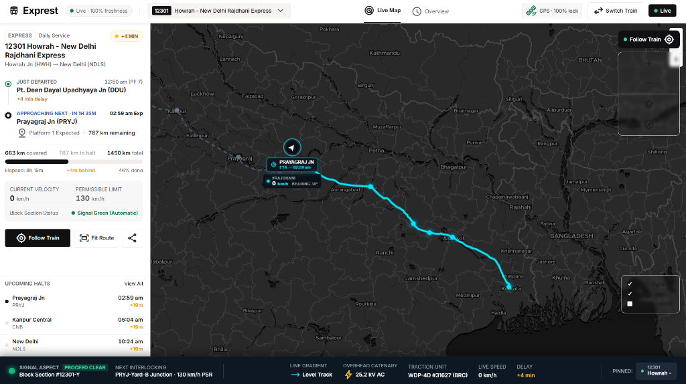
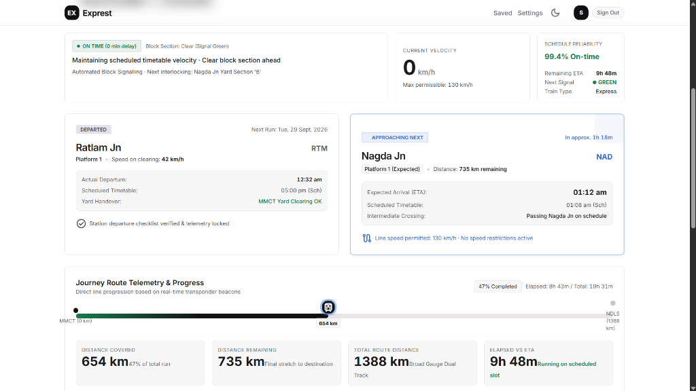
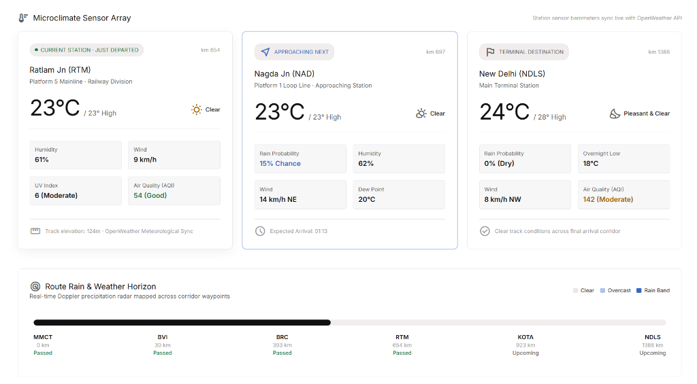
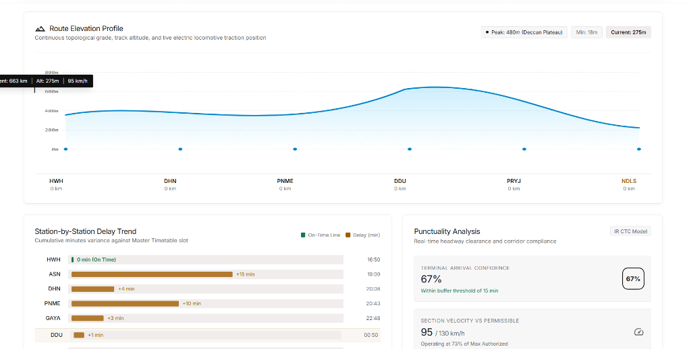
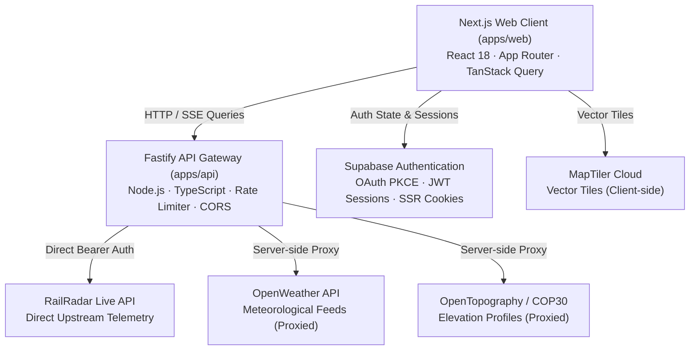

<div align="center">
  <h1>🚄 Exprest</h1>
  <p><strong>Next-Gen Real-Time Train Telemetry, Journey Tracking & Route Intelligence Platform</strong></p>
  <p>
    <a href="https://exprest.vercel.app/"><strong>Explore Live Application »</strong></a>
    ·
    <a href="#-local-development"><strong>Quickstart Guide</strong></a>
    ·
    <a href="#-deployment-guide"><strong>Production Deployment</strong></a>
  </p>
  
  [](https://opensource.org/licenses/MIT)
  []()
  []()
  []()
  []()
  []()
</div>

<br />

**Exprest** is a high-performance, real-time train tracking and rail intelligence system purpose-built for Indian Railways. Engineered as a modern monorepo with Next.js, Fastify, and Turborepo, it unites live GPS radar positioning, interactive vector route maps, meteorological telemetry, elevation profiles, and secure Supabase authentication into a unified, responsive interface.

---

## 📸 Interface Preview

| 🗺️ Live Radar Map | 📍 Journey Overview |
| :---: | :---: |
|  |  |
| **Track trains with smooth MapLibre vector tiles and a dynamic HUD radar marker.** | **Monitor real-time velocity, distance covered, upcoming halts, and live delays.** |

| 🌤️ Route Weather Companion | 📊 Delay Analytics & Elevation |
| :---: | :---: |
|  |  |
| **Inspect ambient meteorological conditions and forecasts along your corridor.** | **Analyze historical halt delays, punctuality trends, and COP30 elevation profiles.** |

---

## ✨ Verified Features

- **📡 Direct Live Railway Telemetry:** Direct integration with upstream RailRadar API for real-time train search, schedules, current station status, delays, and velocity.
- **🗺️ Interactive Vector Maps:** Fluid MapLibre GL mapping with vector tiles powered by MapTiler and automatic route bounds fitting.
- **⏱️ Schedule & Punctuality Engine:** Real-time delay calculations, departed vs upcoming halts, actual vs scheduled arrival/departure times.
- **🌙 Overnight Journey Span Handling:** Intelligent IST midnight boundary matching for multi-day overnight express runs (e.g. Rajdhani express departing previous evening).
- **🌤️ Contextual Weather Companion:** Real-time temperature, wind, humidity, and atmospheric conditions sampled along the active journey route via OpenWeather.
- **⛰️ Topographic Elevation Profiles:** Route terrain altitude visualization powered by Copernicus DEM COP30 via OpenTopography.
- **🔗 Shareable Journey Snapshots:** Lightweight share links allowing travelers to share real-time journey progress with family and companions.
- **🔐 Authoritative Supabase Authentication:** Email/password registration and Google OAuth with PKCE flow, validated server-side through `@supabase/ssr` middleware.
- **🛡️ Strict Production CORS Protection:** Explicit origin allowlisting protecting API gateways while accommodating Vercel preview and canonical production domains.

---

## 🛠️ Architecture & Data Flow



---

## 📂 Repository Structure

The repository is organized as a **pnpm workspace** orchestrated by **Turborepo**:

```text
Exprest/
├── apps/
│   ├── api/                 # Fastify backend service (Node.js, TypeScript)
│   │   ├── src/             # Route handlers, CORS policy, provider adapters
│   │   ├── test/            # Node test runner regression test suites
│   │   └── package.json
│   └── web/                 # Next.js 14 web application (App Router)
│       ├── app/             # Application routes, layouts, and API callbacks
│       ├── components/      # UI components, radar maps, and controls
│       ├── lib/             # Supabase client/server session helpers
│       └── package.json
├── packages/
│   ├── config/              # Shared Zod environment schemas & validation
│   ├── types/               # Canonical TypeScript domain types & API contracts
│   └── ui/                  # Shared styling design tokens & base UI utilities
├── docs/                    # Architecture documentation & screenshots
├── supabase/                # PostgreSQL migration schemas (profiles, RLS)
├── pnpm-workspace.yaml      # Monorepo workspace configuration
├── turbo.json               # Turborepo task pipeline definitions
└── package.json             # Root monorepo workspace scripts
```

---

## 💻 Local Development

### Prerequisites

- **Node.js**: `v18.0.0` or higher (Node 20+ recommended)
- **pnpm**: `v9.0.0` or higher

### 1. Installation

```bash
# Clone the repository
git clone https://github.com/Sujalkan07/Exprest.git
cd Exprest

# Install monorepo dependencies with frozen lockfile
pnpm install --frozen-lockfile
```

### 2. Environment Configuration

Create local environment files for both applications:

**Frontend configuration:** Copy `apps/web/.env.example` to `apps/web/.env.local`:
```env
NEXT_PUBLIC_API_URL=http://localhost:4000
NEXT_PUBLIC_MAPTILER_KEY=your_maptiler_api_key
NEXT_PUBLIC_SUPABASE_URL=https://your-project.supabase.co
NEXT_PUBLIC_SUPABASE_ANON_KEY=your_supabase_anon_key
```

**Backend configuration:** Copy `apps/api/.env.example` to `apps/api/.env`:
```env
PORT=4000
NODE_ENV=development
PUBLIC_APP_URL=http://localhost:3000

# Required for live train telemetry
RAILRADAR_API_KEY=your_railradar_api_key

# Optional Meteorological & Elevation Providers
OPENWEATHER_API_KEY=your_openweather_api_key
OPENTOPOGRAPHY_API_KEY=your_opentopography_api_key
```

### 3. Running the Stack

```bash
# Start both backend and frontend development servers concurrently
pnpm dev

# Alternatively, run via Turborepo
pnpm dev:turbo
```

- **Frontend application:** `http://localhost:3000`
- **Backend API gateway:** `http://localhost:4000`
- **Health check endpoint:** `http://localhost:4000/health`

---

## 🔑 Environment Variables Reference

### Frontend (`apps/web`)

| Variable | Description | Exposure | Required |
| :--- | :--- | :--- | :--- |
| `NEXT_PUBLIC_API_URL` | Base URL of the Fastify API backend (`http://localhost:4000` or `https://exprest.onrender.com`). | Client Bundle | Yes |
| `NEXT_PUBLIC_MAPTILER_KEY` | Public MapTiler key for vector tile streaming in MapLibre. | Client Bundle | Yes |
| `NEXT_PUBLIC_SUPABASE_URL` | Supabase project URL (`https://<project-ref>.supabase.co`). | Client Bundle | Yes |
| `NEXT_PUBLIC_SUPABASE_ANON_KEY` | Supabase public anonymous API key for browser client sessions. | Client Bundle | Yes |

> [!IMPORTANT]
> Variables prefixed with `NEXT_PUBLIC_` are baked into the frontend JavaScript bundle during `next build`. Whenever you change any `NEXT_PUBLIC_*` variable on Vercel, you must trigger a **Redeploy** on Vercel for the changes to take effect.

### Backend (`apps/api`)

| Variable | Description | Exposure | Required |
| :--- | :--- | :--- | :--- |
| `PORT` | Listening port for Fastify server (Defaults to `4000` locally, or auto-assigned by Render). | Server-only | Yes |
| `NODE_ENV` | Environment mode (`development`, `production`, `test`). | Server-only | Yes |
| `PUBLIC_APP_URL` | Canonical frontend URL used for share links and primary CORS origin (`https://exprest.vercel.app`). | Server-only | Yes |
| `CORS_ALLOWED_ORIGINS` | Comma-separated list of allowed origins in production (e.g. `https://exprest-git-main-sujal-kansals-projects.vercel.app,https://exprest.vercel.app`). | Server-only | Yes |
| `RAILRADAR_API_KEY` | Upstream API bearer key for live Indian Railways telemetry from RailRadar. | Server-only | Yes |
| `OPENWEATHER_API_KEY` | API key for ambient route weather forecasts. | Server-only | Optional |
| `OPENTOPOGRAPHY_API_KEY` | API key for high-res route elevation (falls back to COP30 DEM if unset). | Server-only | Optional |

---

## 🔒 Supabase Authentication Setup

1. Create a project at [supabase.com](https://supabase.com).
2. Open the **SQL Editor**, paste the contents of [`supabase/migrations/001_create_profiles.sql`](supabase/migrations/001_create_profiles.sql), and execute. This initializes the `public.profiles` schema with automated row-level security and user registration triggers.
3. In **Authentication -> URL Configuration**, configure the site and redirect callback URLs:
   - Site URL: `https://exprest.vercel.app`
   - Redirect URLs:
     - `http://localhost:3000/auth/callback`
     - `https://exprest.vercel.app/auth/callback`
     - `https://exprest-git-main-sujal-kansals-projects.vercel.app/auth/callback`
4. If using **Google OAuth**, enable Google in **Authentication -> Providers** and register the Supabase callback URI in your Google Cloud Console Credentials.
5. If "Confirm email" is enabled in Supabase settings, new email/password registrations will require email verification before sign-in.

---

## 🚢 Deployment Guide

### Backend: Render Web Service

1. Create a **New Web Service** connected to your GitHub repository.
2. Configure service parameters:
   - **Environment:** `Node`
   - **Root Directory:** *(leave blank for root workspace)*
   - **Build Command:**
     ```bash
     npx pnpm install --prod=false && npx pnpm --filter @exprest/types build && npx pnpm --filter @exprest/api build
     ```
   - **Start Command:**
     ```bash
     node apps/api/dist/app.js
     ```
3. Add Environment Variables on Render:
   - `NODE_ENV`: `production`
   - `RAILRADAR_API_KEY`: `<your_railradar_api_key>`
   - `PUBLIC_APP_URL`: `https://exprest.vercel.app`
   - `CORS_ALLOWED_ORIGINS`: `https://exprest-git-main-sujal-kansals-projects.vercel.app,https://exprest.vercel.app`
   - `OPENWEATHER_API_KEY`: *(optional)*
   - `OPENTOPOGRAPHY_API_KEY`: *(optional)*

> [!NOTE]
> Changes to Render environment variables trigger a zero-downtime service restart to apply updated allowlists.

### Frontend: Vercel Web Application

1. Import the repository into [Vercel](https://vercel.com).
2. Configure project settings:
   - **Framework Preset:** `Next.js`
   - **Root Directory:** `apps/web`
3. Add Environment Variables on Vercel:
   - `NEXT_PUBLIC_API_URL`: `https://exprest.onrender.com`
   - `NEXT_PUBLIC_MAPTILER_KEY`: `<your_maptiler_key>`
   - `NEXT_PUBLIC_SUPABASE_URL`: `https://<project-ref>.supabase.co`
   - `NEXT_PUBLIC_SUPABASE_ANON_KEY`: `<your_supabase_anon_key>`
4. Deploy the project.

---

## 🌐 Production CORS Architecture

Modern browsers enforce Cross-Origin Resource Sharing (CORS) when client web applications hosted on Vercel make asynchronous fetch calls to API gateways on Render.

In production (`NODE_ENV=production`), Exprest strictly enforces an explicit origin allowlist generated from `PUBLIC_APP_URL` and `CORS_ALLOWED_ORIGINS`:

- **Canonical Domain:** `https://exprest.vercel.app`
- **Git Branch Deployments:** `https://exprest-git-main-sujal-kansals-projects.vercel.app`

Because Vercel generates unique deployment URLs for branch builds, any domain accessing the API gateway must be specified in the backend's `CORS_ALLOWED_ORIGINS` configuration. Unrestricted wildcards (`*`) are disallowed in production to prevent malicious third-party cross-site credential exploitation.

---

## 📡 Live Telemetry & ScraperAPI Evaluation

Previous iterations explored proxying upstream requests via ScraperAPI. During production verification, direct authenticated communication between Render and RailRadar (`https://railradar.in/api/v1`) with a valid `RAILRADAR_API_KEY` was tested and confirmed:

- Direct RailRadar queries succeed with sub-second latencies and complete telemetry accuracy.
- Proxying through third-party scrapers introduced unnecessary latency, credit exhaustion risks, and 401 failure points.
- Consequently, ScraperAPI proxy logic was removed in favor of a clean, direct, authenticated upstream integration.

---

## 🧪 Quality Gates & Testing

Run all quality checks from the repository root:

```bash
# Execute TypeScript typechecking across all workspace packages
pnpm typecheck

# Run Next.js and ESLint code audits
pnpm lint

# Execute Node.js test runner unit and integration test suite (44+ tests)
pnpm test

# Build production artifacts across monorepo workspaces
pnpm build
```

The test suite in [`apps/api/test/`](apps/api/test/) validates:
1. **Punctuality & Timing Integrity:** Accurate IST calendar day formatting across midnight UTC boundaries.
2. **Canonical Status Normalization:** Robust parsing of upstream statuses (`RUNNING`, `ON_TIME`, `DELAYED`, `COMPLETED`, `NOT_STARTED`).
3. **Multi-Day Journey Date Matching:** Proper tracking resolution for multi-day overnight runs.
4. **CORS Allowlist Security:** Verification that allowed origins receive appropriate CORS headers while untrusted domains are rejected.
5. **Credential Redaction:** Verification that sensitive API keys are never leaked into diagnostic logs or error messages.

---

## 🛡️ Security Notes

- **Credential Rotation:** Never commit `.env` or `.env.local` files to version control. If an API key is accidentally exposed in screenshots or logs, rotate the key in the provider dashboard immediately.
- **Log Sanitization:** Upstream adapters run error messages through `redactCredentials()` to scrub credentials before writing to log streams.
- **Open Redirect Defense:** The OAuth authentication callback route validates internal destination paths to neutralize open-redirect vulnerabilities.
- **Authorization:** Protected pages and API mutations are safeguarded by Supabase Auth sessions verified through `@supabase/ssr`.

---

## 📄 License

This project is licensed under the [MIT License](LICENSE).
